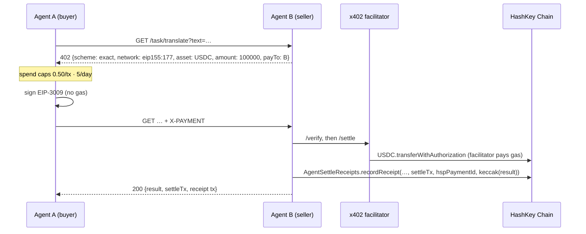

# AgentSettle (HSP, x402)

> Agents hire and pay each other on HashKey Chain: an HTTP 402 price, a gasless EIP-3009 USDC payment settled by an
> x402 facilitator, HSP as the second settlement rail, and one on-chain receipt per paid task.

**Built for the HashKey Chain Horizon Hackathon (Mumbai), track: Agent Payments & A2A Settlement.**
Demo video: [YOUTUBE_URL] · Contract (HashKey Chain mainnet): [CONTRACT_ADDRESS] · Facilitator PR: [PR_URL]

## The problem

When an AI agent hires another agent, three things have to work without a human in the loop:

1. **A price over HTTP.** The seller has to say "pay me this, in this token, on this chain" in a form a machine can act on.
2. **Settlement the buyer can afford and anyone can verify.** That means no custody and no gas juggling for the buyer.
3. **A receipt others can trust.** It has to link the payment, the payer, the payee and the work that was delivered.

On top of that, an autonomous buyer needs **guardrails**, so a bug or a malicious seller cannot drain its wallet.

## What it does

1. **Agent A (buyer)** asks **Agent B (seller)** for a micro-task (`GET /task/translate?text=…`).
2. B answers **`402 Payment Required`** with an x402 v2 `exact` requirement:
   - USDC on HashKey Chain (`eip155:177` on mainnet, `eip155:133` on testnet)
   - `amount: 100000` (0.10 USDC)
   - `payTo` = B
   - the token's EIP-712 domain
3. A checks its **spend policy**: 0.50 USDC per transaction and 5 USDC per day. Only then does it sign an **EIP-3009 `transferWithAuthorization`**. A pays no gas.
4. A retries with the `X-PAYMENT` header.
5. B sends the payment to the **x402 facilitator** (`/verify`, then `/settle`). The facilitator broadcasts the transfer on HashKey Chain and pays the gas.
6. B delivers the result and writes **`AgentSettleReceipts.recordReceipt(taskId, payer, payee, token, amount, settleTx, hspPaymentId, keccak256(result))`**.
7. **HSP rail:** the same task is paid through HashKey's **HSP SDK** on testnet. The flow is `pay()`, then `awaitSettled()`, then `HSPVerifier.verify()` returning **ACCEPT**. The receipt then carries the `hspPaymentId`.
8. When A is asked for 2 USDC, the per-transaction cap **refuses before anything is signed**. This is shown in the demo.



## Try it (judges: under 5 minutes, no keys, no funds)

You need Node 20+, git and [Foundry](https://getfoundry.sh) (`curl -L https://foundry.paradigm.xyz | bash && foundryup`).

```bash
git clone --recurse-submodules [REPO_URL] agentsettle-hsk && cd agentsettle-hsk
scripts/demo.sh            # local chain: anvil + an EIP-3009 USDC mock with the same EIP-712 domain as HashKey testnet USDC
```

**Do this, see that:**

| Do | See |
|---|---|
| `scripts/demo.sh` | It runs this sequence: 402 → spend check → EIP-3009 signed → facilitator settles → `Hola mundo, agentes pagan agentes` delivered → `recordReceipt` tx. Then it shows the 2 USDC task **denied** and the HSP rail (marked SIMULATED until the sandbox credentials arrive). |
| `scripts/demo.sh --ui`, then open http://127.0.0.1:8402 | The judge console opens, with receipts seeded from the run. |
| Click **Hire Agent B · 0.10 USDC** | The flow animates: the 402 body, the signature with "gas paid by buyer: 0", the settle tx, and the receipt tx. A new row appears in **On-chain receipts**. |
| Click **Premium task · 2.00 USDC** | "Spend policy DENIED: 2.00 USDC is over the per-transaction cap of 0.50 USDC". Nothing was signed. |
| `curl -i "http://127.0.0.1:8402/task/translate?text=hello"` | A raw `HTTP/1.1 402` with the x402 `accepts` body and a `PAYMENT-REQUIRED` header. |
| `scripts/reset.sh` | Clean slate: the local chain state and the spend ledger are cleared. |

On HashKey testnet or mainnet, the same command prints Blockscout links for every transaction:
- **Testnet:** `cp .env.example .env`, fill the testnet keys and `RECEIPTS_ADDRESS_TESTNET`, then run `scripts/demo.sh --network hashkey-testnet --runs 3`.
- **Mainnet:** `MAINNET_OWNER_OK=yes scripts/demo.sh --network hashkey`. Mainnet refuses to run without that flag.

## How we use HashKey Chain and HSP (sponsor tech, with file paths)

| Sponsor tech | Where | What |
|---|---|---|
| **HashKey Chain mainnet (177) and testnet (133)** | [`src/config.ts`](src/config.ts) | Chain IDs, RPCs and Blockscout links. Bridged USDC `0x054ed45810DbBAb8B27668922D110669c9D88D0a` with domain "Bridged USDC" v2 on mainnet. The HSP sandbox USDC `0x8FE3cB719Ee4410E236Cd6b72ab1fCDC06eF53c6` with domain "USD Coin" v2 on testnet. Both domains were re-checked against `DOMAIN_SEPARATOR()` on-chain. |
| **USDC EIP-3009 on HashKey** | [`src/rails/x402.ts`](src/rails/x402.ts) | x402 v2 `exact` requirements; the buyer signs `TransferWithAuthorization` for chain 177/133. |
| **x402 facilitator with HashKey support** | `UltravioletaDAO/x402-rs` ([PR_URL]) · [`src/agents/seller.ts`](src/agents/seller.ts) | The seller calls `/verify` and `/settle` through `uvd-x402-sdk`'s `FacilitatorClient` (network `eip155:177`). [`src/facilitator/local.ts`](src/facilitator/local.ts) is a local stand-in with the same wire format, used until production lists HashKey. |
| **On-chain receipts** | [`contracts/AgentSettleReceipts.sol`](contracts/AgentSettleReceipts.sol) | Mainnet: [CONTRACT_ADDRESS] (https://explorer.hsk.xyz/address/[CONTRACT_ADDRESS]). Testnet: [TESTNET_CONTRACT_ADDRESS]. |
| **HSP SDK** | [`src/rails/hsp.ts`](src/rails/hsp.ts) · [`src/agents/hsp-flow.ts`](src/agents/hsp-flow.ts) | `HSPClient.pay()`, `payX402()` and `HSPVerifier.verify()` against the pinned adapter. ACCEPT means ship. The receipt carries the `hspPaymentId` (= mandateHash). Coordinator explorer: [HSP_EXPLORER_LINK]. |
| **Spend guardrails (same shape as HSP SpendGuard)** | [`src/spend-guard.ts`](src/spend-guard.ts) | A per-tx cap of 0.50 USDC and a daily cap of 5 USDC. A spend is booked at signing time. |

Transactions on HashKey Chain: [TX_LINKS on explorer.hsk.xyz]

## Status (kept honest)

| Piece | State |
|---|---|
| Contract + Foundry tests (10 for the contract, 5 for the local USDC mock) | ✅ |
| x402 flow end to end (seller, SDK client, facilitator, EIP-3009 transfer, receipt) on a local chain | ✅ covered by `test/e2e-local.test.ts` and `test/guards-e2e.test.ts` |
| Contract on HashKey testnet | ⏳ waiting for faucet HSK on the operator wallet |
| x402 settle on HashKey testnet | ⏳ waiting for test USDC (`0x8FE3…`) on the buyer wallet |
| Production facilitator with `hashkey` / `hashkey-testnet` | ⏳ in review in `x402-rs` (separate PR) |
| HSP sandbox (`pay`, `payX402`, `HSPVerifier`) | ⏳ code ready behind `src/rails/hsp.ts`; it runs as a labelled stub until the organizer shares the credentials and the SDK repo |
| Mainnet deploy + settlements | ⏳ only after the owner approves the exact amounts ([docs/FUNDING.md](docs/FUNDING.md)) |
| EAS attestation per receipt, ERC-8004 feedback | not built (P1/P2) |

## Safety

- **The buyer refuses before signing** in these cases:
  - another network, another token, or an unknown EIP-712 domain;
  - a malformed or zero amount;
  - anything over its caps.
- **The seller checks every payment against its own price,** not against the buyer's copy. It delivers only after the facilitator verified **and** settled with a transaction hash. A replayed `X-PAYMENT` is refused.
- **`taskId` is derived from the payment** (chain, payer, EIP-3009 nonce). A retried delivery therefore cannot write a second receipt: the contract reverts with `exists`.
- **Mainnet guard:** nothing runs on chain 177 unless `MAINNET_OWNER_OK=yes` is set. On mainnet only the production facilitator settles.
- **Keys** live only in `.env`, which is gitignored. They are never logged, never echoed in errors, and never returned by the API. `gitleaks` runs in CI on every commit.

## Built before vs. during the hackathon

- **Existed before. We use these through their public interfaces only:**
  - Ultravioleta's open-source x402 facilitator ([x402-rs](https://github.com/UltravioletaDAO/x402-rs)). Its HashKey support is a hackathon PR in that repo.
  - The TypeScript SDK [`uvd-x402-sdk`](https://www.npmjs.com/package/uvd-x402-sdk).
  - HashKey's HSP SDK, from the organizer.
  - Foundry and forge-std.
- **Built during the hackathon (Oct 29 – Nov 1, 2026):** everything in this repository. Commit range: `cac5ebf`…[LAST_COMMIT].

## Repository layout

```
contracts/AgentSettleReceipts.sol      receipts contract (+ test/, script/Deploy.s.sol, mocks/MockEIP3009.sol for local runs)
src/agents/buyer.ts                    Agent A: caps -> sign EIP-3009 -> X-PAYMENT
src/agents/seller.ts                   Agent B: 402 -> verify/settle -> task -> recordReceipt
src/agents/hsp-flow.ts                 the same task over HSP
src/rails/x402.ts · src/rails/hsp.ts   the two payment rails
src/facilitator/local.ts               local x402 facilitator (same wire format as x402-rs)
src/receipts.ts                        recordReceipt + receipt listing
src/spend-guard.ts                     per-tx and daily caps
src/app.ts · src/cli/*                 demo server, `pnpm demo`, `pnpm start`
web/                                   judge console (Vite)
scripts/demo.sh · scripts/reset.sh     one-command demo, clean slate
docs/WALLETS.md · docs/FUNDING.md      public addresses; mainnet funding route with exact amounts
```

## Tests

```bash
forge test                        # contract: operator-only (with fuzz), no duplicate taskId, event, storage
pnpm install && pnpm test         # unit + end-to-end on anvil: payment, receipt fields, caps, replay, forged signature,
                                  # tampered price, broke buyer, every facilitator guard, concurrent settle
bash scripts/ci/preflight.sh      # exactly what CI runs (Node 20, pnpm 10, Foundry, gitleaks)
```

## Team

Ultravioleta DAO: Luis ([LUIS_X_HANDLE]) and c0der. Built with help from AI coding agents.

## License

MIT. See [LICENSE](LICENSE).
