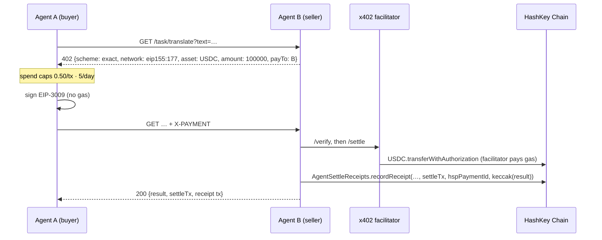

# AgentSettle (HSP, x402)

> Agents hire and pay each other on HashKey Chain: an HTTP 402 price, a gasless EIP-3009 USDC payment settled by an
> x402 facilitator, HSP as the second settlement rail, and one on-chain receipt per paid task.

**Built for the HashKey Chain Horizon Hackathon (Mumbai), track: Agent Payments & A2A Settlement.**
Demo video: [YOUTUBE_URL] · Contract (HashKey Chain mainnet): [`0xb8956dFe…08a1`](https://explorer.hsk.xyz/address/0xb8956dFe5819b9828b6D55315bFB871c443f08a1) · Payment test (Ethereum Sepolia, Circle USDC): [settle tx](https://sepolia.etherscan.io/tx/[SEPOLIA_SETTLE_TX]) · Facilitator PR: [x402-rs#132](https://github.com/UltravioletaDAO/x402-rs/pull/132)

## The problem

When an AI agent hires another agent, three things have to work without a human in the loop:

1. **A price over HTTP.** The seller has to say "pay me this, in this token, on this chain" in a form a machine can act on.
2. **Settlement the buyer can afford and anyone can verify.** That means no custody and no gas juggling for the buyer.
3. **A receipt others can trust.** It has to link the payment, the payer, the payee and the work that was delivered.

On top of that, an autonomous buyer needs **guardrails**, so a bug or a malicious seller cannot drain its wallet.

## What it does

1. **Agent A (buyer)** asks **Agent B (seller)** for a micro-task (`GET /task/translate?text=…`).
2. B answers **`402 Payment Required`** with an x402 v2 `exact` requirement:
   - USDC on HashKey Chain (`eip155:177` on mainnet, `eip155:133` on testnet)
   - `amount: 100000` (0.10 USDC)
   - `payTo` = B
   - the token's EIP-712 domain
3. A checks its **spend policy**: 0.50 USDC per transaction and 5 USDC per day. Only then does it sign an **EIP-3009 `transferWithAuthorization`**. A pays no gas.
4. A retries with the `X-PAYMENT` header.
5. B sends the payment to the **x402 facilitator** (`/verify`, then `/settle`). The facilitator broadcasts the transfer on HashKey Chain and pays the gas.
6. B delivers the result and writes **`AgentSettleReceipts.recordReceipt(taskId, payer, payee, token, amount, settleTx, hspPaymentId, keccak256(result))`**.
7. **HSP rail:** the same task is paid through **HSP Agentic Payment**, HashKey's MCP server (QA, HashKey Chain testnet, USDC), with `pnpm hsp:pay`.
   - The order: `get_chain_config` → `create_order` (a one-time cart mandate for B) → `get_order`.
   - The person at the terminal confirms `merchant_name`, then `pay_to`, then the payer, one at a time with no defaults.
   - `prepare_payment` returns the EIP-712 data to sign. A **checks it before signing** and refuses anything else:
     - it must be `TransferWithAuthorization`, the EIP-3009 struct, on this chain and on the token `get_chain_config` lists;
     - from the confirmed payer to the confirmed `pay_to`, for exactly `token_total_raw`;
     - at most the price + 10%, valid for at most an hour.
   - A also checks its balance. The person approves `pay_to`, payer and `token_total_raw`, then A signs with its own key, which never goes to the server.
   - A second approval comes before the signature leaves the process: whoever holds it can execute the transfer until `validBefore`. A "no", or an expired quote, means it is never sent.
   - Then `finalize_payment` hands it to HSP and `submit_payment` submits the mandate unchanged. The gateway broadcasts the transfer.
   - `query_payment` runs every 15 s until `payment-safe`, `payment-finalized` or `payment-failed`, and reports `attribution_verified`. After 10 minutes it reports "Pending confirmation".
   - B delivers only after the mined tx consumes **that** authorization and moves exactly `token_total_raw` from A to B: the `Transfer` must be the log right after its `AuthorizationUsed`. The receipt carries the HSP `payment_request_id` as `hspPaymentId`.
8. When A is asked for 2 USDC, the per-transaction cap **refuses before anything is signed**. This is shown in the demo.



## Try it (judges: under 5 minutes, no keys, no funds)

You need Node 20+, git and [Foundry](https://getfoundry.sh) (`curl -L https://foundry.paradigm.xyz | bash && foundryup`).

```bash
git clone --recurse-submodules https://github.com/0xultravioleta/agentsettle-hsk agentsettle-hsk && cd agentsettle-hsk
scripts/demo.sh            # local chain: anvil + an EIP-3009 USDC mock with the same EIP-712 domain as HashKey testnet USDC
```

**Do this, see that:**

| Do | See |
|---|---|
| `scripts/demo.sh` | It runs this sequence: 402 → spend check → EIP-3009 signed → facilitator settles → `Hola mundo, agentes pagan agentes` delivered → `recordReceipt` tx. Then it shows the 2 USDC task **denied**. Locally the HSP step is marked SIMULATED; on testnet the HSP step is `pnpm hsp:pay`, which asks a person to confirm each value. |
| `scripts/demo.sh --ui`, then open http://127.0.0.1:8402 | The judge console opens, with receipts seeded from the run. |
| Click **Hire Agent B · 0.10 USDC** | The flow animates: the 402 body, the signature with "gas paid by buyer: 0", the settle tx, and the receipt tx. A new row appears in **On-chain receipts**. |
| Click **Premium task · 2.00 USDC** | "Spend policy DENIED: 2.00 USDC is over the per-transaction cap of 0.50 USDC". Nothing was signed. |
| `curl -i "http://127.0.0.1:8402/task/translate?text=hello"` (with `--ui` running) | A raw `HTTP/1.1 402` with the x402 `accepts` body and a `PAYMENT-REQUIRED` header. |
| `scripts/reset.sh` | Clean slate: the local chain state and the spend ledger are cleared. |

On a public chain, the same command prints explorer links for every transaction:
- **Ethereum Sepolia (where HashKey asks teams to test USDC payments, with Circle's USDC):** fill the testnet keys in `.env`, run `scripts/deploy.sh ethereum-sepolia`, then `scripts/demo.sh --network ethereum-sepolia --runs 1`. The production facilitator has no `exact` scheme there, so AgentSettle's own facilitator ([`src/facilitator/local.ts`](src/facilitator/local.ts)) settles, with W5 paying the gas.
- **HashKey testnet:** `cp .env.example .env`, fill the testnet keys and `RECEIPTS_ADDRESS_TESTNET`, then run `scripts/demo.sh --network hashkey-testnet --runs 3`.
- **HSP on testnet:** `pnpm hsp:pay`. It makes ONE HSP Agentic Payment and asks you to confirm each value. W6 needs testnet USDC `0x8FE3…` first; `HSP_MCP_NETWORK=base-sepolia` switches to the fallback chain.
- **Mainnet:** `MAINNET_OWNER_OK=yes scripts/demo.sh --network hashkey`. Mainnet refuses to run without that flag.

## How we use HashKey Chain and HSP (sponsor tech, with file paths)

| Sponsor tech | Where | What |
|---|---|---|
| **HashKey Chain mainnet (177) and testnet (133)** | [`src/config.ts`](src/config.ts) | Chain IDs, RPCs and Blockscout links. Bridged USDC `0x054ed45810DbBAb8B27668922D110669c9D88D0a` with domain "Bridged USDC" v2 on mainnet. The HSP sandbox USDC `0x8FE3cB719Ee4410E236Cd6b72ab1fCDC06eF53c6` with domain "USD Coin" v2 on testnet. Both domains were re-checked against `DOMAIN_SEPARATOR()` on-chain. |
| **Ethereum Sepolia (11155111): the USDC payment test HashKey asks for** | [`src/config.ts`](src/config.ts) · [`src/facilitator/local.ts`](src/facilitator/local.ts) | Circle's USDC `0x1c7D4B196Cb0C7B01d743Fbc6116a902379C7238` with domain "USDC" v2, read from the token and matched against `DOMAIN_SEPARATOR()` on-chain. The production facilitator lists only escrow and commerce there, so AgentSettle's own facilitator settles the EIP-3009 transfer (W5 pays the gas). |
| **USDC EIP-3009 on HashKey** | [`src/rails/x402.ts`](src/rails/x402.ts) | x402 v2 `exact` requirements; the buyer signs `TransferWithAuthorization` for chain 177/133. |
| **x402 facilitator with HashKey support** | `UltravioletaDAO/x402-rs` ([#132](https://github.com/UltravioletaDAO/x402-rs/pull/132), merged) · [`src/agents/seller.ts`](src/agents/seller.ts) | The seller calls `/verify` and `/settle` through `uvd-x402-sdk`'s `FacilitatorClient` (network `eip155:177`). [`src/facilitator/local.ts`](src/facilitator/local.ts) is a local stand-in with the same wire format. On testnet it is used while production does not list HashKey or reports it down. |
| **On-chain receipts** | [`contracts/AgentSettleReceipts.sol`](contracts/AgentSettleReceipts.sol) | Mainnet: [`0xb8956dFe5819b9828b6D55315bFB871c443f08a1`](https://explorer.hsk.xyz/address/0xb8956dFe5819b9828b6D55315bFB871c443f08a1), deployed by W3 in [tx 0x9f86a835…](https://explorer.hsk.xyz/tx/0x9f86a83512b32dc223336420bef95bc05d93c8c1613b1d1c0e6454d0a2caba8c) (block 29602850) and verified on Blockscout. Testnet: [`0xaE84CA772f0ECA0Af6A79bEd82270Bb41F1A6Df1`](https://testnet-explorer.hskchain.net/address/0xaE84CA772f0ECA0Af6A79bEd82270Bb41F1A6Df1) (verified on Blockscout). |
| **HSP Agentic Payment (MCP)** | [`src/rails/hsp-mcp.ts`](src/rails/hsp-mcp.ts) · [`src/agents/hsp-mcp-flow.ts`](src/agents/hsp-mcp-flow.ts) · [`src/cli/hsp-pay.ts`](src/cli/hsp-pay.ts) | The eight tools over Streamable HTTP (`@modelcontextprotocol/sdk` 1.32.1, pinned). Agent A pays B's cart mandate itself: `create_order` → `get_order` → `prepare_payment` → our check of the EIP-712 data (`checkTypedData`) → EIP-712 signature by A → `finalize_payment` → `submit_payment` → `query_payment`. A person confirms `merchant_name`, `pay_to`, the payer, and each signature and submission. B delivers only after the transfer is on-chain. |
| **HSP REST rail (HashKey Merchant API), off the critical path** | [`src/rails/hsp-merchant.ts`](src/rails/hsp-merchant.ts) · [`src/rails/hsp.ts`](src/rails/hsp.ts) · [`src/agents/hsp-flow.ts`](src/agents/hsp-flow.ts) | One-time cart mandates on the QA gateway (`hashkey-testnet`, USDC): HMAC-SHA256 request signing, the ES256K `merchant_authorization` JWT over the canonical cart hash, payment queries and signed webhooks (`/hsp/webhook`). The merchant key and the app credentials live in AWS SSM, never in the repo ([docs/hsp/REGISTRATION.md](docs/hsp/REGISTRATION.md)). The receipt carries the `payment_request_id`. |
| **Spend guardrails (same shape as HSP SpendGuard)** | [`src/spend-guard.ts`](src/spend-guard.ts) | A per-tx cap of 0.50 USDC and a daily cap of 5 USDC. A spend is booked at signing time. |

Transactions:
- **Payment test on Ethereum Sepolia (Circle USDC), as HashKey asks:** contract [`[SEPOLIA_CONTRACT]`](https://sepolia.etherscan.io/address/[SEPOLIA_CONTRACT]) ([deploy tx](https://sepolia.etherscan.io/tx/[SEPOLIA_DEPLOY_TX])), one 0.10 USDC payment W6 → W5 [settled](https://sepolia.etherscan.io/tx/[SEPOLIA_SETTLE_TX]) by our own facilitator, and [its receipt](https://sepolia.etherscan.io/tx/[SEPOLIA_RECEIPT_TX]).
- **HashKey Chain:** the contract deploys, on [mainnet](https://explorer.hsk.xyz/tx/0x9f86a83512b32dc223336420bef95bc05d93c8c1613b1d1c0e6454d0a2caba8c) and [testnet](https://testnet-explorer.hskchain.net/tx/0xd2f083d1f44ecf293239653b06ab1bc0b93d9d17fecb12ff7cfff4a938c1bf60).

## Status (kept honest)

| Piece | State |
|---|---|
| Contract + Foundry tests (10 for the contract, 5 for the local USDC mock, 1 for the deploy guard) | ✅ |
| x402 flow end to end (seller, SDK client, facilitator, EIP-3009 transfer, receipt) on a local chain | ✅ covered by `test/e2e-local.test.ts` and `test/guards-e2e.test.ts` |
| Contract on HashKey testnet | ✅ [`0xaE84CA77…`](https://testnet-explorer.hskchain.net/address/0xaE84CA772f0ECA0Af6A79bEd82270Bb41F1A6Df1), deployed by W5 in [tx 0xd2f083d1…](https://testnet-explorer.hskchain.net/tx/0xd2f083d1f44ecf293239653b06ab1bc0b93d9d17fecb12ff7cfff4a938c1bf60) (block 35115376) and verified on Blockscout |
| x402 payment on Ethereum Sepolia (Circle USDC, settled by our own facilitator) | ⏳ waiting for Circle USDC on W6 and Sepolia ETH on W5; then one deploy and one 0.10 USDC payment |
| x402 settle on HashKey testnet | ⏳ waiting for test USDC (`0x8FE3…`) on the buyer wallet |
| Production facilitator with `hashkey` / `hashkey-testnet` | ✅ listed in `/supported` (2.52.0) and its `/verify` accepts our v2 payload on both chains · ✅ `/health/ready` reports both networks `ok`, their signers with gas (checked 2026-11-01) |
| HSP Agentic Payment (MCP, QA) | ✅ the QA MCP server answers our IP (initialize, the eight tools, `get_chain_config`; read-only, 2026-11-01) · ✅ client and flow tested against a fake server that replays the recorded tool schemas, plus an anvil e2e (`test/hsp-mcp*.test.ts`) · ⏳ one real payment with `pnpm hsp:pay` once W6 holds testnet USDC (`0x8FE3…`) |
| HSP REST rail (HashKey Merchant API) | ✅ built and tested (`test/hsp-merchant*.test.ts`) · off the critical path: its QA API still answers 403, and HSP Agentic Payment needs no credentials |
| Contract on HashKey Chain mainnet | ✅ [`0xb8956dFe…`](https://explorer.hsk.xyz/address/0xb8956dFe5819b9828b6D55315bFB871c443f08a1), deployed by W3 on 2026-11-01 in [tx 0x9f86a835…](https://explorer.hsk.xyz/tx/0x9f86a83512b32dc223336420bef95bc05d93c8c1613b1d1c0e6454d0a2caba8c) (block 29602850, 318,089 gas, 0.159 HSK) and verified on Blockscout |
| Paid runs on HashKey Chain | No paid run has happened on HashKey Chain yet: HashKey asks for USDC payment tests on Ethereum Sepolia (the row above), and winners migrate to mainnet afterwards. The contract above is ready for that. |
| EAS attestation per receipt, ERC-8004 feedback | not built (P1/P2) |

## Safety

- **The buyer refuses before signing** in these cases:
  - another network, another token, or an unknown EIP-712 domain;
  - a payee other than the agent it hired;
  - a malformed or zero amount;
  - anything over its caps.

  Its signature stays valid for at most 10 minutes, whatever the seller asks.
- **The seller checks every payment against its own price,** not against the buyer's copy. It delivers only when three things hold:
  - the facilitator verified the payment;
  - the facilitator settled it;
  - the mined transaction shows `AuthorizationUsed(payer, nonce)` and, as the very next log, the exact USDC transfer to the seller. Another transfer in the same transaction does not count, and a facilitator's word alone is not enough.
- **A retried `X-PAYMENT`** (for example, after a lost response) gets the same delivery back: no second charge and no second receipt. The same authorization reused for a different task gets `409`, never a new `402`.
- **`taskId` is derived from the payment** (chain, payer, EIP-3009 nonce). A retried delivery therefore cannot write a second receipt: the contract reverts with `exists`.
- **The console API (`/api/*`) only answers the console itself.** It requires a JSON body, a same-origin `Origin`/`Sec-Fetch-Site`, and our own `Host`, which stops DNS rebinding.
- **The local facilitator** listens on its own loopback port. It refuses browser requests and settles only payments to our seller.
- **Mainnet guard:** nothing runs on chain 177 unless `MAINNET_OWNER_OK=yes` is set. `scripts/deploy.sh` and the app take it only from the command line of that run, never from `.env`. `Deploy.s.sol` checks it as well, but a bare `forge script` does read it from `.env` (forge loads `.env` itself), so that line never goes in `.env`. `scripts/deploy.sh hashkey` also refuses while `.env` already holds `RECEIPTS_ADDRESS_MAINNET`, unless it gets `--redeploy`. On mainnet only the production facilitator settles, and the run refuses to start while its `/health/ready` marks HashKey down.
- **Keys** live only in `.env`, which is gitignored. They are never logged, never echoed in errors, and never returned by the API. `gitleaks` runs in CI on every commit.

## Built before vs. during the hackathon

- **Existed before. We use these through their public interfaces only:**
  - Ultravioleta's open-source x402 facilitator ([x402-rs](https://github.com/UltravioletaDAO/x402-rs)). Its HashKey support is a hackathon PR in that repo ([#132](https://github.com/UltravioletaDAO/x402-rs/pull/132), merged on 2026-10-30, live in 2.52.0).
  - The TypeScript SDK [`uvd-x402-sdk`](https://www.npmjs.com/package/uvd-x402-sdk).
  - HashKey's HSP: HSP Agentic Payment (the MCP server, through the setup guide HSP sent the teams) and the HashKey Merchant API (through its public docs).
  - The MCP TypeScript SDK ([`@modelcontextprotocol/sdk`](https://www.npmjs.com/package/@modelcontextprotocol/sdk)).
  - Foundry and forge-std.
- **Built during the hackathon (Oct 29 – Nov 2, 2026):** everything in this repository. Commit range: `cac5ebf`…[LAST_COMMIT].

## Repository layout

```
contracts/AgentSettleReceipts.sol      receipts contract (+ test/, script/Deploy.s.sol, mocks/MockEIP3009.sol for local runs)
src/agents/buyer.ts                    Agent A: caps -> sign EIP-3009 -> X-PAYMENT
src/agents/seller.ts                   Agent B: 402 -> verify/settle -> task -> recordReceipt
src/agents/hsp-mcp-flow.ts             the same task over HSP Agentic Payment (confirmations, checks, polling, receipt)
src/rails/hsp-mcp.ts · src/cli/hsp-pay.ts   HSP MCP client, checkTypedData; `pnpm hsp:pay` (one run, a person confirms)
src/agents/hsp-flow.ts                 the HSP REST rail flow (off the critical path)
src/rails/x402.ts · src/rails/hsp.ts   the x402 rail; the HSP REST rail
src/rails/hsp-merchant.ts              HashKey Merchant API: HMAC signing, ES256K cart JWT, payments, webhooks
src/hsp-secrets.ts · src/cli/hsp-keygen.ts   HSP secrets in AWS SSM; merchant key pair (`pnpm hsp:keygen`)
src/facilitator/local.ts               local x402 facilitator (same wire format as x402-rs)
src/receipts.ts                        recordReceipt + receipt listing
src/spend-guard.ts                     per-tx and daily caps
src/app.ts · src/cli/*                 demo server, `pnpm demo`, `pnpm start`
web/                                   judge console (Vite)
scripts/demo.sh · scripts/reset.sh     one-command demo, clean slate
docs/WALLETS.md · docs/FUNDING.md      public addresses; mainnet funding route with exact amounts
docs/hsp/                              HSP registration data and the merchant public key
```

## Tests

```bash
forge test                        # contract: operator-only (with fuzz), no duplicate taskId, event, storage; deploy guard
pnpm install && pnpm test         # unit + end-to-end on anvil: payment, receipt fields, caps, retries and replays,
                                  # forged signature, tampered price, broke buyer, every facilitator guard, concurrent
                                  # settle, lost settle response, lying facilitator, cross-site requests; HSP: the docs'
                                  # recorded examples, a fake gateway that re-checks HMAC/JWT/cart_hash, lying records;
                                  # HSP Agentic Payment: a fake MCP server replaying the recorded tool schemas, one test
                                  # per field we refuse to sign, every "no" of the person, lying payment records
bash scripts/ci/preflight.sh      # exactly what CI runs (Node 20, pnpm 10, Foundry, gitleaks)
```

## Team

Ultravioleta DAO: Luis ([LUIS_X_HANDLE]) and c0der. Built with help from AI coding agents.

## License

MIT. See [LICENSE](LICENSE).
